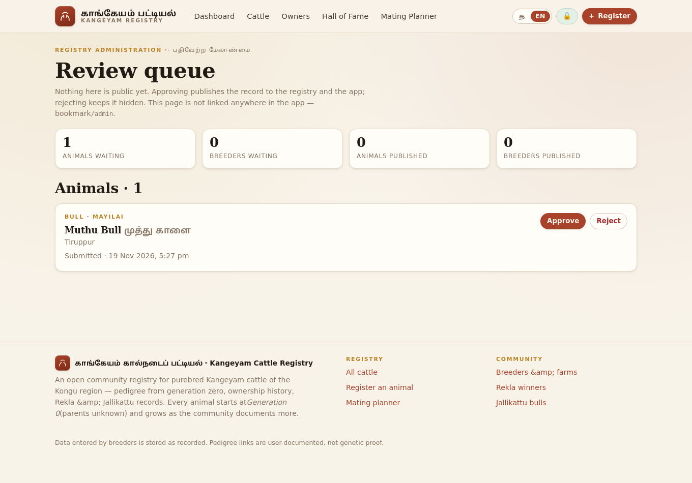
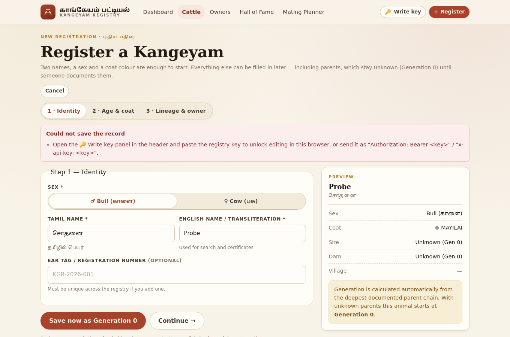

# காங்கேயம் பட்டியல் · Kangeyam Cattle Pedigree, Registry & Achievement Platform

A full-stack registry for purebred **Kangeyam (Kangayam) cattle** of the Kongu region of Tamil Nadu —
built around one core idea: **historical pedigrees for indigenous cattle are incomplete, so the system
must work from zero.** Every newly registered animal starts at **Generation 0** (parents unknown) and its
lineage grows organically, backwards and forwards, as breeders document more.

Anyone can **submit** a bull, cow or breeder without an account — the record is queued and stays
invisible until a registry administrator approves it at `/admin`, which is not linked anywhere in
the app.



Screens in `docs/screenshots/`: dashboard, cattle registry, animal profile, pedigree tree,
mating planner, QR certificate, ownership timeline, a 360 px mobile view, the submission
confirmation, the review queue (desktop + mobile) and the locked admin page.

---

## 1. What's inside

```
kangeyam/
├── server/                 Node + Express + SQLite REST API (also serves the built UI)
│   ├── src/
│   │   ├── index.js        All REST routes under /api/v1
│   │   ├── lib.js          Enums, pedigree maths, Wright's F, serialisation, validation
│   │   ├── schema.sql      Full relational schema
│   │   ├── seed.js         optional demo herd (29 animals, 8 owners, 27 achievements)
│   │   ├── reset.js        `npm run db:wipe` / `db:reset` — empty or re-seed the registry
│   │   └── db.js           libSQL (SQLite/Turso) connection, migrations, optional seeding
│   ├── public/media/       9 photographs of Kangeyam cattle, Rekla, Jallikattu
│   └── data/kangeyam.db    SQLite database (created empty on first run)
└── web/                    Ember.js 5.12 (Octane) application
    ├── app/router.js       Bookmarkable routes for every entity, incl. the unlinked /admin
    ├── app/services/api.js Native-fetch API service layer
    ├── app/services/i18n.js Locale state, {{tr}} / {{lbl}} / {{nm}} lookup, <html lang>
    ├── app/utils/dictionary.js English → Tamil dictionary + server-string patterns
    ├── scripts/i18n-check.js `npm run i18n:check` — lists untranslated strings
    ├── app/components/     Glimmer components (recursive pedigree tree, animal search…)
    ├── app/templates/      One template per route
    └── app/styles/app.css  Bespoke mobile-first design system (no CSS framework)
```

## 2. Running it

```bash
# one-time
cd server && npm install
cd ../web && npm install

# build the Ember app once (outputs to web/dist, served by Express)
cd web && npx ember build --environment=production

# run everything on http://localhost:4000
cd ../server && npm start
```

The Express server serves both `/api/v1/*` and the compiled Ember SPA (with history-mode
fallback), so there is a single origin — no CORS or proxy configuration needed.

The registry starts **empty** — no demo animals. Commands for the local database:

```bash
cd server
npm run db:wipe     # delete every record, keep the schema
npm run db:reset    # wipe, then load the 29-animal demo herd
npm run seed        # load the demo herd into an empty database
SEED_DEMO_DATA=1 npm start   # same thing, at boot
```

Nothing is seeded automatically, and a snapshot of the old demo database is kept at
`.backup/kangeyam-demo-seed-2026-11-19.db` (git-ignored) in case you want it back.

*(`node_modules` is not part of the saved workspace snapshot — run the two `npm install`
commands again if the sandbox was recycled.)*

### Deploying to Vercel

The repo deploys as **one Vercel project with two services** (`vercel.json` at the root):

| Service | Root | Framework | Public path |
| --- | --- | --- | --- |
| `api` | `server/` | `express` (entrypoint `src/index.js`) | `/api/*` |
| `web` | `web/` | `ember` (build `npm run build`, output `dist`) | everything else |

Live deployment: **https://kangeyam-pedigree.vercel.app** (project `kangeyam-pedigree`, production
alias of branch `main`). Verified end-to-end on that URL: every route returns 200, `/api/v1/*`
answers from the `api` service, `/assets`, `/media`, `/fonts` are served by `web`, and a browser
`POST`/`DELETE` round-trip on `/api/v1/animals` returns 201/200.

`web` is a static Ember build, so it does not call `api` from Node — the **browser** calls
`/api/v1/*` on the same origin, which the top-level rewrite sends to the `api` service. That is
why there are no service bindings: nothing in either service performs a server-side call to the
other. The Ember client's base URL is already relative (`web/app/services/api.js` → `/api/v1`).

```bash
npx vercel link --yes            # project: kangeyam-pedigree (or import the repo in the dashboard)
npx vercel env pull              # after adding the two variables below
npx vercel --prod                # deploy
```

| Setting | Value |
| --- | --- |
| Framework preset (project) | *Other* — services come from `vercel.json` |
| Install command | per service, default `npm install` in `server/` and `web/` |
| Build command | `web`: `npm run build` (`ember build --environment=production`) |
| Output directory | `web`: `dist` |
| Node.js | 22.x |

**Persistence.** Serverless functions have no writable disk, so `server/src/db.js` speaks the
better-sqlite3-compatible libSQL API: point it at a hosted database and the same synchronous
queries run over HTTPS.

```
TURSO_DATABASE_URL=libsql://<db>-<org>.turso.io
TURSO_AUTH_TOKEN=<token>
WRITE_API_KEY=<long random string>     # see "Write access"; without it the deployment is read-only
```

Without those two variables the function falls back to `/tmp` and seeds the demo registry on
each cold start — every page works, but edits vanish after the instance is recycled. To create
the hosted database: `turso db create kangeyam`, `turso db show kangeyam --url`,
`turso db tokens create kangeyam`, then load the schema + seed once with
`turso db shell kangeyam < server/src/schema.sql` (or start the deployed API and let the first
request seed an empty database).

`GET /api/v1/health` reports `{"status":"ok","animals":29,"database":"turso|file|ephemeral"}`
so you can confirm which mode a deployment is in.

---

## 3. Core modelling decisions

### 0-to-n generation pedigree
* `sire_id` / `dam_id` are nullable self-references; `NULL` = unknown parent.
* `documented_generations` is **computed**, not stored: `0` for an animal with no recorded
  parents, otherwise `1 + max(parent generations)`. The seeded herd reaches **Generation 5**
  (Vel → Semmai → Veeran → Kannan → Ilavel → Vetri).
* Depth is unlimited. `GET /animals/:id/pedigree?depth=n` resolves an arbitrarily deep tree;
  the UI renders it as a horizontally scrollable bracket chart.
* Parent links are validated against **cycles**: an animal can never become its own ancestor,
  and a bull can only be a sire / a cow only a dam.

### Stub ancestors
A breeder who remembers only a name and a village can create an `is_stub` animal. Stubs appear
in the tree with a dashed border, count towards generations, and can be **upgraded** later by
editing the profile and unticking “keep as stub”.

### Ownership is a history, not a column
`animal_ownerships` holds `BREEDER → PREVIOUS_OWNER 1..n → CURRENT_OWNER` with
`sequence_order`, optional `from_date` / `to_date` and a `place_note`. Adding a new
`CURRENT_OWNER` automatically demotes the previous one — so 0, 1 or many owners are all valid.

### Compatible mating (lineage simulator)
Both animals' ancestors are collected to unlimited depth and intersected. Only the **closest**
shared ancestors (those that are not themselves ancestors of another shared ancestor) contribute
to Wright's coefficient of inbreeding for the hypothetical calf:

```
F = Σ (½)^(n₁ + n₂ + 1) · (1 + F_A)
```

so half-siblings score 12.5 %, parent × offspring 25 %, unrelated 0 %. The response also returns
a plain-language relationship (“First cousins”, “Uncle / aunt × niece / nephew”), risk banding and
warnings for direct parent–offspring pairings or wrong-sex parents.

### Bilingual by default
`name_ta`, `name_en`, owner names, colour classes and all UI labels exist in both scripts — and the
whole interface can be switched between Tamil and English (§6).
Search (`?q=`) matches Tamil and English names, tags, villages, distinctive markings and owner
names in a single query. A self-hosted Noto Sans Tamil webfont (`web/public/fonts`) guarantees
Tamil renders even on devices without a Tamil system font.

### Privacy
`owners.is_contact_public` defaults to `false`. The API omits `phone` entirely unless the owner
opted in, so masked numbers can never leak through the JSON.

---

## 4. Submissions & moderation

The registry is open to submissions but published by exception:

| Who | Can |
| --- | --- |
| anyone | `POST /animals`, `POST /owners` (one animal or breeder at a time, with optional `submitter_name` / `submitter_phone`) |
| anyone | read everything that is **approved** |
| admin (registry key) | everything else: approve, reject, edit, delete, media, ownerships, achievements, breeding events, stub ancestors |

A submission is stored with `review_status = 'PENDING'` and disappears from every public surface —
lists, search, stats, the achievements feed, the owners directory, the mating planner and even
`GET /animals/:id` (404). Approving flips it to `APPROVED` and it appears everywhere at once;
rejecting leaves it hidden but keeps the row (and the submitter's note) for reference.

The two forms in the app react to this: after submitting, the farmer sees a confirmation card
("waiting for review", with the queue number) instead of a profile page.

### The admin queue — `/admin`

Not linked from the navigation, the footer or any button: bookmark `https://…/admin`.
It lists pending animals and breeders with the submitter's name/phone, the linked owner, the
sire/dam if given, and Approve / Reject buttons plus counters.

The page renders in three states:

1. **Locked** — this browser has no registry key (paste it into the 🔑 Write key
   control on this page; the queue loads as soon as it is saved).
2. **Queue** — pending animals and breeders, oldest first.
3. **All clear** — nothing waiting.

Approving an animal also approves the breeder records that arrived with it (same submission),
so a first-time farmer does not need two approvals.

---

## 5. REST API — `/api/v1`

| Method | Path | Notes |
| --- | --- | --- |
| GET | `/meta` | Enumerations with Tamil + English labels |
| GET | `/stats` | Dashboard counters, colour & category breakdowns |
| GET | `/animals` | `?q=&sex=&color=&village=&district=&min_generations=&has_achievements=&has_media=&sort=&page=&per_page=` |
| POST | `/animals` | Public submission → `202` + `PENDING`; with the admin key → `201` + `APPROVED`. Accepts `owner_id` or inline `owner {}` and `media []` |
| GET | `/animals/:id` | Full profile + media, ownerships, achievements, progeny, computed generation |
| PATCH | `/animals/:id` | Partial update incl. parent links (cycle-checked) |
| DELETE | `/animals/:id` | Hard delete, or **archive** when the animal is a recorded ancestor |
| GET | `/animals/:id/pedigree?depth=n` | Recursive `sire` / `dam` tree, `by_generation`, `offspring` |
| GET | `/pedigree/compatibility?sire_id=&dam_id=` | Shared ancestors, Wright's F, risk, warnings |
| GET/POST | `/animals/:id/media` | Photos & videos, `life_stage`, `is_primary` |
| PATCH/DELETE | `/animals/:id/media/:mediaId` | Set primary, edit caption / stage, remove |
| GET/POST | `/animals/:id/ownerships` | Ordered timeline; can inline-create an owner |
| PATCH/DELETE | `/animals/:id/ownerships/:ownershipId` | Reorder, re-date, remove |
| GET/POST | `/owners` | Directory search `?q=&district=&village=`; `POST` is a public submission (202 + `PENDING`) |
| GET/PATCH | `/owners/:id` | Profile + currently / previously owned cattle |
| GET | `/achievements` | Global feed + leaderboard `?category=&q=&year=&sex=` |
| GET/POST | `/animals/:id/achievements` | Includes `partner_animal_id` for paired Rekla bulls |
| PATCH/DELETE | `/animals/:id/achievements/:achievementId` | Edit / remove |
| GET | `/breeding-events` | Mating → expected calving → calf log |
| GET | `/animals/:id/qr.svg` | QR badge used by the printable certificate |
| GET | `/admin/queue` | **Admin.** Pending animals + breeders, submitter contacts, counters |
| POST | `/admin/animals/:id/review` | **Admin.** `{"action":"approve"\|"reject"\|"pending","note":"…"}` |
| POST | `/admin/owners/:id/review` | **Admin.** Same body; owners linked to an approved animal are published with it |

Errors use standard codes with a JSON body:

```json
{ "errors": [{ "status": 422, "title": "Validation failed",
               "detail": ["dam_id: Semmai is a BULL, expected a COW"] }] }
```

### Access control

One middleware in `server/src/index.js` decides everything, before any handler runs:

| `WRITE_API_KEY` | Environment | Effect |
| --- | --- | --- |
| set | anywhere | the key (as `Authorization: Bearer <key>` or `x-api-key: <key>`, constant-time compared) marks the request as **admin** |
| unset | local dev | everyone is an admin, so `npm start` stays frictionless |
| unset | `NODE_ENV=production` / Vercel | **nobody** is an admin — submissions still queue, but nothing can be approved, edited or deleted |

Strangers may always `POST /animals` and `POST /owners`; every other mutation needs the key.
Reads are public but return **approved rows only** — unless the request carries the key, in which
case pending rows are included (`?include_pending=1`) so `/admin` can preview them.

`GET /api/v1/health` reports the active mode:

```json
{ "data": { "status": "ok", "animals": 0, "owners": 0, "writes": "key", "reads": "public",
            "submissions": "open", "is_admin": false, "database": "file" } }
```

A refused write answers:

```json
{ "errors": [{ "status": 401, "title": "Admin access requires a key",
  "detail": "Open /admin and paste the key into the 🔑 Write key control …" }] }
```

The Ember client attaches the key from `localStorage` (`kangeyam.writeKey`). Set it with the
**🔑 Write key** control on `/admin`, or with a link such as `https://…/?key=<key>` — the app
stores it and strips it from the URL so it stays out of history.

This is a shared secret for a small registry team, not per-user authentication: anyone you send
the key to becomes an admin, and a browser holding it can read it back. Put real accounts in front
of the same middleware (the `keyMatches()` seam) before letting untrusted editors in.

---

### Write access


<!-- /docs/screenshots -->

Reads are always public. Every mutating route (`POST`, `PATCH`, `PUT`, `DELETE`) is gated by
`server/src/index.js`, in one place, before any handler runs:

| `WRITE_API_KEY` | Environment | Writes |
| --- | --- | --- |
| set | anywhere | allowed only with the key, as `Authorization: Bearer <key>` or `x-api-key: <key>` (constant-time compare) |
| unset | local / `NODE_ENV!==production` | open, so `npm start` stays frictionless |
| unset | `NODE_ENV=production` or on Vercel | **locked** — every write returns `401 This deployment is read-only` |

`GET /api/v1/health` reports the active mode:

```json
{ "data": { "status": "ok", "animals": 29, "database": "turso", "writes": "key", "reads": "public" } }
```

A wrong or missing key answers:

```json
{ "errors": [{ "status": 401, "title": "Write access requires a key",
  "detail": "Open /admin and paste the key into the 🔑 Write key control …" }] }
```

The Ember client attaches the key from `localStorage` (`kangeyam.writeKey`). Two ways to set it:
the **🔑 Write key** button in the header, or a link such as
`https://…/?key=<key>` — the app stores it and strips it from the URL so it stays out of history.
This is a shared secret for a small registry team, not per-user authentication: anyone you send
the key to can write, and the browser that holds it can read it back. Put per-user accounts in
front of it before letting untrusted editors in.

---

## 6. Language — தமிழ் / English

The UI ships in both languages; nothing is machine-translated at runtime.

| Where | What |
| --- | --- |
| header pill `த | EN` | switches the whole app instantly, no reload |
| `localStorage.kangeyam.locale` | remembers the choice (`ta` / `en`) |
| first visit | follows `navigator.language` — a `ta-*` browser starts in Tamil, everything else in English |
| `<html lang>` | kept in sync, so screen readers, hyphenation and the Tamil webfont all agree |

**How strings are stored.** English source text is the key, Tamil lives in
`web/app/utils/dictionary.js` (~630 entries). A missing entry falls back to English instead of
leaking a key into the page, and `npm run i18n:check` (in `web/`) reports every string used without
a translation — it exits non-zero with `--ci`, so a gap fails the build rather than the farmer.

Templates use three helpers:

```hbs
{{tr "Register an animal"}}                    {{! UI copy }}
{{tr "{{n}} generations documented" n=3}}      {{! copy with numbers baked in }}
{{lbl animal.labels.current_color}}            {{! server label pairs {ta, en} }}
{{nm animal}} {{nm2 animal}}                   {{! primary name + the other script, muted }}
```

Sentences the API composes — age labels (`4 yrs (year only)`), kinship (`First cousins`), verdicts,
`X is an ancestor of Y` — are matched by the small `patterns` table next to the dictionary, so the
server can keep returning one canonical English structure.

**One field, one name.** No form ever asks for the same thing twice: registration, the breeder
directory, stub ancestors and the ownership timeline each have a single *Name* input, and the owner
types it in whichever script they like. The server (`resolveNames()` in `server/src/lib.js`) records
it in both `name_ta` and `name_en`, so search, sorting and certificates work either way, while API
callers that genuinely have both names still send `name_ta` / `name_en` explicitly. When a record
does have two different names, the primary follows the active language and the other script is
shown as the secondary line.

**Photos.** Every animal carries an optional gallery of up to **10** images
(`MAX_MEDIA_PER_ANIMAL` in `server/src/lib.js` — one number to raise). The data model is
one `animal_media` row per image with no fixed columns, so scaling to *n* images needs no
schema change, only that constant. Owners attach photos **while registering** (on the
registration form) or later from the gallery — files are resized on-device first (≤1600 px JPEG) because
uploads travel inside the JSON request, which Vercel caps at 4.5 MB. The gallery no longer
offers free-text image URLs; the API still accepts `media_url` for programmatic clients.

**Hero.** The dashboard hero crossfades through six photographs in `web/public/hero/`
every 4 seconds (paused for visitors who prefer reduced motion).

**What is *not* translated:** a breeder's own words (notes, captions, achievement titles) and
free-text village names are stored once and shown exactly as entered; the common Kongu Nadu
villages, districts and coat/sex/dentition vocabularies are mapped. Bilingual record names use
`name_ta` in Tamil mode and `name_en` in English mode, with the other script kept as the secondary
line, so a Tamil reader never loses the Latin spelling they can type into search.

## 7. Ember routes

```
/                                  dashboard
/animals                           registry + filters (all query-param driven, shareable)
/animals/new                       single-page registration form (parents optional → Gen 0)
/animals/:id                       profile overview (owner, achievements, progeny, depth ladder)
/animals/:id/pedigree?depth=2..5   interactive 0-to-n family tree
/animals/:id/achievements          race / show / dairy / progeny log + add form
/animals/:id/gallery               multi-stage photo & video timeline
/animals/:id/ownership             breeder → previous owners → current owner timeline
/animals/:id/edit                  details, DOB precision, dentition, parents, archive
/animals/:id/card                  printable QR pedigree certificate (print CSS included)
/owners  /owners/new  /owners/:id  /owners/:id/edit
/achievements  /achievements/rekla  /achievements/jallikattu  /achievements/shows
/mating-planner?sire=:id&dam=:id   compatibility simulator (bookmarkable)
/admin                             review queue — unlinked, admin key required
```

`/admin` is deliberately absent from the header, the mobile menu and the footer: it is reached by
typing the URL. Submitting `/animals/new` or `/owners/new` without the key shows the
"waiting for review" confirmation instead of redirecting to the (still hidden) profile.

## 8. Seed data (optional)

The shipped database is **empty**. `npm run db:reset` loads the demo herd that the screenshots
were taken with: 29 animals across six generations, 8 breeders/farms (Thambi Farms, Vellakoil
Kangeyam Kudil, Kongu Semmai Farms…), 27 achievements (Rekla timings, *Pidipadaatha Kaalai*
Jallikattu bulls, Best Kangeyam Dam, A2 lactation records, progeny milestones) and 3 stub
ancestors — enough to exercise every screen, including a deliberately line-bred branch for the
mating planner. Every seeded row is written as `APPROVED`, i.e. published.

## 9. Design notes

Warm paper, terracotta and ochre; serif display type; large touch targets and single-page forms for
rural mobile use; no CSS framework, no external CDN (fonts, icons and photographs are all
self-hosted) so the registry works on a slow village connection.
