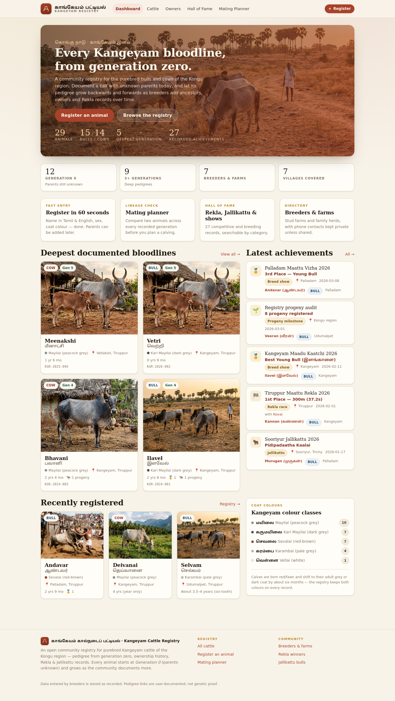

# காங்கேயம் பட்டியல் · Kangeyam Cattle Pedigree, Registry & Achievement Platform

A full-stack registry for purebred **Kangeyam (Kangayam) cattle** of the Kongu region of Tamil Nadu —
built around one core idea: **historical pedigrees for indigenous cattle are incomplete, so the system
must work from zero.** Every newly registered animal starts at **Generation 0** (parents unknown) and its
lineage grows organically, backwards and forwards, as breeders document more.



Screens in `docs/screenshots/`: dashboard, cattle registry, animal profile, pedigree tree,
mating planner, QR certificate, ownership timeline and a 360 px mobile view.

---

## 1. What's inside

```
kangeyam/
├── server/                 Node + Express + SQLite REST API (also serves the built UI)
│   ├── src/
│   │   ├── index.js        All REST routes under /api/v1
│   │   ├── lib.js          Enums, pedigree maths, Wright's F, serialisation, validation
│   │   ├── schema.sql      Full relational schema
│   │   ├── seed.js         29 animals, 8 owners, 27 achievements, real Kongu bloodlines
│   │   └── db.js           better-sqlite3 connection + auto-seed
│   ├── public/media/       9 photographs of Kangeyam cattle, Rekla, Jallikattu
│   └── data/kangeyam.db    SQLite database (created + seeded automatically)
└── web/                    Ember.js 5.12 (Octane) application
    ├── app/router.js       Meaningful, bookmarkable routes for every entity
    ├── app/services/api.js Native-fetch API service layer
    ├── app/components/     Glimmer components (recursive pedigree tree, animal search…)
    ├── app/templates/      One template per route
    └── app/styles/app.css  Bespoke mobile-first design system (no CSS framework)
```

## 2. Running it

```bash
# one-time
cd server && npm install
cd ../web && npm install

# build the Ember app once (outputs to web/dist, served by Express)
cd web && npx ember build --environment=production

# run everything on http://localhost:4000
cd ../server && npm start
```

The Express server serves both `/api/v1/*` and the compiled Ember SPA (with history-mode
fallback), so there is a single origin — no CORS or proxy configuration needed.

To wipe and re-seed the registry: delete `server/data/kangeyam.db*` and restart.

*(`node_modules` is not part of the saved workspace snapshot — run the two `npm install`
commands again if the sandbox was recycled.)*

### Deploying to Vercel

The repo is already wired for Vercel: `api/index.js` exports the entire Express app as one
Node function, and `vercel.json` builds the Ember app into `web/dist`, routes `/api/*` to the
function and keeps `/assets`, `/media`, `/fonts` out of the SPA fallback.

```bash
npx vercel link --yes            # project: kangeyam-pedigree (or import the repo in the dashboard)
npx vercel env pull              # after adding the two variables below
npx vercel --prod                # deploy
```

| Setting | Value |
| --- | --- |
| Install command | `npm install --prefix server --omit=dev && npm install --prefix web` |
| Build command | `npm --prefix web run build` |
| Output directory | `web/dist` |
| Node.js | 22.x |

**Persistence.** Serverless functions have no writable disk, so `server/src/db.js` speaks the
better-sqlite3-compatible libSQL API: point it at a hosted database and the same synchronous
queries run over HTTPS.

```
TURSO_DATABASE_URL=libsql://<db>-<org>.turso.io
TURSO_AUTH_TOKEN=<token>
```

Without those two variables the function falls back to `/tmp` and seeds the demo registry on
each cold start — every page works, but edits vanish after the instance is recycled. To create
the hosted database: `turso db create kangeyam`, `turso db show kangeyam --url`,
`turso db tokens create kangeyam`, then load the schema + seed once with
`turso db shell kangeyam < server/src/schema.sql` (or start the deployed API and let the first
request seed an empty database).

`GET /api/v1/health` reports `{"status":"ok","animals":29,"database":"turso|file|ephemeral"}`
so you can confirm which mode a deployment is in.

---

## 3. Core modelling decisions

### 0-to-n generation pedigree
* `sire_id` / `dam_id` are nullable self-references; `NULL` = unknown parent.
* `documented_generations` is **computed**, not stored: `0` for an animal with no recorded
  parents, otherwise `1 + max(parent generations)`. The seeded herd reaches **Generation 5**
  (Vel → Semmai → Veeran → Kannan → Ilavel → Vetri).
* Depth is unlimited. `GET /animals/:id/pedigree?depth=n` resolves an arbitrarily deep tree;
  the UI renders it as a horizontally scrollable bracket chart.
* Parent links are validated against **cycles**: an animal can never become its own ancestor,
  and a bull can only be a sire / a cow only a dam.

### Stub ancestors
A breeder who remembers only a name and a village can create an `is_stub` animal. Stubs appear
in the tree with a dashed border, count towards generations, and can be **upgraded** later by
editing the profile and unticking “keep as stub”.

### Ownership is a history, not a column
`animal_ownerships` holds `BREEDER → PREVIOUS_OWNER 1..n → CURRENT_OWNER` with
`sequence_order`, optional `from_date` / `to_date` and a `place_note`. Adding a new
`CURRENT_OWNER` automatically demotes the previous one — so 0, 1 or many owners are all valid.

### Compatible mating (lineage simulator)
Both animals' ancestors are collected to unlimited depth and intersected. Only the **closest**
shared ancestors (those that are not themselves ancestors of another shared ancestor) contribute
to Wright's coefficient of inbreeding for the hypothetical calf:

```
F = Σ (½)^(n₁ + n₂ + 1) · (1 + F_A)
```

so half-siblings score 12.5 %, parent × offspring 25 %, unrelated 0 %. The response also returns
a plain-language relationship (“First cousins”, “Uncle / aunt × niece / nephew”), risk banding and
warnings for direct parent–offspring pairings or wrong-sex parents.

### Bilingual by default
`name_ta`, `name_en`, owner names, colour classes and all UI labels exist in both scripts.
Search (`?q=`) matches Tamil and English names, tags, villages, distinctive markings and owner
names in a single query. A self-hosted Noto Sans Tamil webfont (`web/public/fonts`) guarantees
Tamil renders even on devices without a Tamil system font.

### Privacy
`owners.is_contact_public` defaults to `false`. The API omits `phone` entirely unless the owner
opted in, so masked numbers can never leak through the JSON.

---

## 4. REST API — `/api/v1`

| Method | Path | Notes |
| --- | --- | --- |
| GET | `/meta` | Enumerations with Tamil + English labels |
| GET | `/stats` | Dashboard counters, colour & category breakdowns |
| GET | `/animals` | `?q=&sex=&color=&village=&district=&min_generations=&has_achievements=&has_media=&sort=&page=&per_page=` |
| POST | `/animals` | Accepts `owner_id` or inline `owner {}` and `media []` for fast entry |
| GET | `/animals/:id` | Full profile + media, ownerships, achievements, progeny, computed generation |
| PATCH | `/animals/:id` | Partial update incl. parent links (cycle-checked) |
| DELETE | `/animals/:id` | Hard delete, or **archive** when the animal is a recorded ancestor |
| GET | `/animals/:id/pedigree?depth=n` | Recursive `sire` / `dam` tree, `by_generation`, `offspring` |
| GET | `/pedigree/compatibility?sire_id=&dam_id=` | Shared ancestors, Wright's F, risk, warnings |
| GET/POST | `/animals/:id/media` | Photos & videos, `life_stage`, `is_primary` |
| PATCH/DELETE | `/animals/:id/media/:mediaId` | Set primary, edit caption / stage, remove |
| GET/POST | `/animals/:id/ownerships` | Ordered timeline; can inline-create an owner |
| PATCH/DELETE | `/animals/:id/ownerships/:ownershipId` | Reorder, re-date, remove |
| GET/POST | `/owners` | Directory search `?q=&district=&village=` |
| GET/PATCH | `/owners/:id` | Profile + currently / previously owned cattle |
| GET | `/achievements` | Global feed + leaderboard `?category=&q=&year=&sex=` |
| GET/POST | `/animals/:id/achievements` | Includes `partner_animal_id` for paired Rekla bulls |
| PATCH/DELETE | `/animals/:id/achievements/:achievementId` | Edit / remove |
| GET | `/breeding-events` | Mating → expected calving → calf log |
| GET | `/animals/:id/qr.svg` | QR badge used by the printable certificate |

Errors use standard codes with a JSON body:

```json
{ "errors": [{ "status": 422, "title": "Validation failed",
               "detail": ["dam_id: Semmai is a BULL, expected a COW"] }] }
```

---

## 5. Ember routes

```
/                                  dashboard
/animals                           registry + filters (all query-param driven, shareable)
/animals/new                       3-step fast registration wizard (save at step 1 = Gen 0)
/animals/:id                       profile overview (owner, achievements, progeny, depth ladder)
/animals/:id/pedigree?depth=2..5   interactive 0-to-n family tree
/animals/:id/achievements          race / show / dairy / progeny log + add form
/animals/:id/gallery               multi-stage photo & video timeline
/animals/:id/ownership             breeder → previous owners → current owner timeline
/animals/:id/edit                  details, DOB precision, dentition, parents, archive
/animals/:id/card                  printable QR pedigree certificate (print CSS included)
/owners  /owners/new  /owners/:id  /owners/:id/edit
/achievements  /achievements/rekla  /achievements/jallikattu  /achievements/shows
/mating-planner?sire=:id&dam=:id   compatibility simulator (bookmarkable)
```

## 6. Seed data

29 animals across six generations, 8 breeders/farms (Thambi Farms, Vellakoil Kangeyam Kudil,
Kongu Semmai Farms…), 27 achievements (Rekla timings, *Pidipadaatha Kaalai* Jallikattu bulls,
Best Kangeyam Dam, A2 lactation records, progeny milestones) and 3 stub ancestors — enough to
exercise every screen, including a deliberately line-bred branch for the mating planner.

## 7. Design notes

Warm paper, terracotta and ochre; serif display type; large touch targets and 3-step forms for
rural mobile use; no CSS framework, no external CDN (fonts, icons and photographs are all
self-hosted) so the registry works on a slow village connection.
